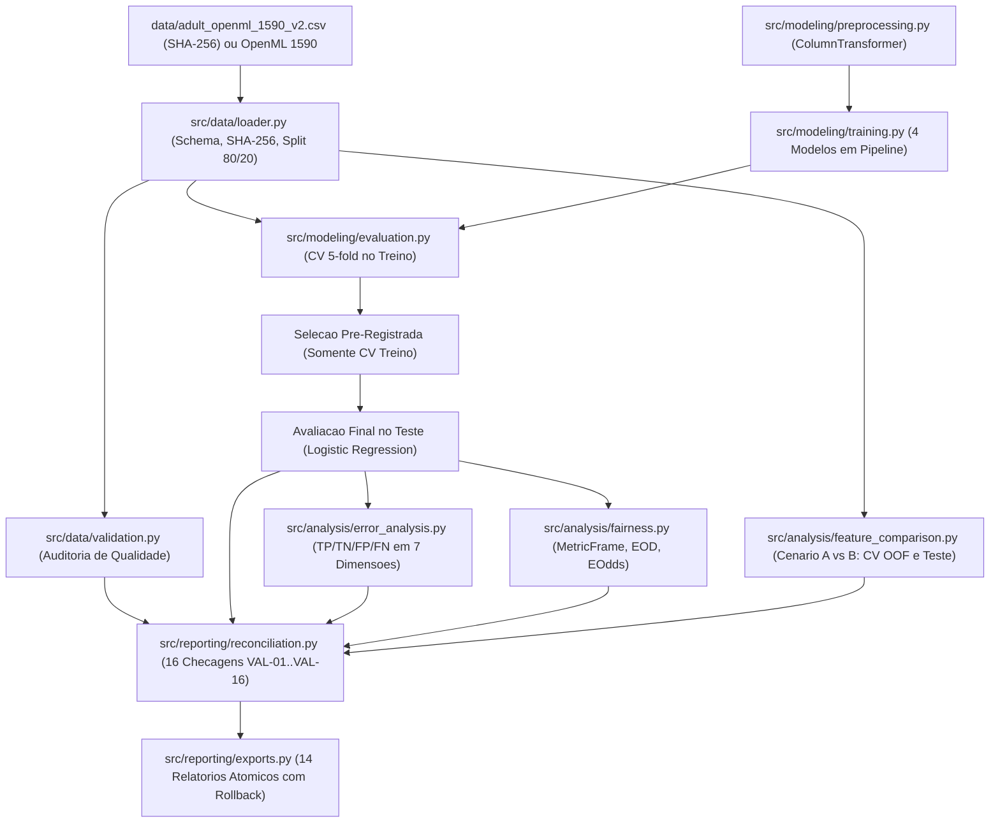

# Adult Income: Model Evaluation & Fairness V2

Laboratório educacional, modular e reproduzível de **avaliação metodológica de modelos de Machine Learning**, **análise de erros de classificação** e **auditoria de fairness (Responsible AI)** construído em Python, Pandas, scikit-learn, Fairlearn e Pytest sobre a base histórica **Adult / Census Income** (OpenML ID 1590, versão 2 / UCI ID 2).

> **Aviso científico e ético obrigatório:** Este projeto é um **laboratório educacional de estudo e portfólio** baseado em dados históricos do Censo dos EUA de 1994. A variável alvo representa apenas uma faixa de renda observada naquela amostra (`<=50K` ou `>50K`). **Este modelo não certifica ausência de discriminação, não representa a população atual e não deve ser utilizado para contratação, concessão de crédito, decisões de emprego ou qualquer decisão real sobre pessoas.**

---

## 1. Problema de Pesquisa e Objetivo

Na minha versão original (V1), construí um notebook exploratório ([notebooks/adult_income_analysis.ipynb](notebooks/adult_income_analysis.ipynb)) que treinou modelos de classificação binária e realizou uma auditoria inicial de fairness com `MetricFrame`. Apesar de metodologicamente cuidadosa, a V1 concentrava todo o fluxo em um único notebook dependente de internet, não incluía o `DummyClassifier` na tabela completa de comparação, não investigava padrões de erro por subgrupo, não avaliava o impacto de remover atributos sensíveis e não possuía reconciliação matemática nem testes automatizados.

Nesta evolução **V2**, meu objetivo foi transformar esse estudo em um laboratório reproduzível de avaliação de modelos e Responsible AI capaz de responder, com evidências verificáveis:

1. Quais problemas estruturais de qualidade, duplicatas, valores ausentes, *top-coding* e pesos amostrais (`fnlwgt`) existem na base?
2. Como `DummyClassifier`, `Logistic Regression`, `Decision Tree` sem limite e `Decision Tree (max_depth=7)` se comparam em treino, validação cruzada e estabilidade entre folds?
3. Por que uma árvore de decisão com quase `100%` de Accuracy no treino generaliza pior fora da amostra?
4. Onde se concentram descritivamente os falsos positivos e falsos negativos do modelo selecionado?
5. Quais disparidades de Accuracy, Recall (TPR), False Positive Rate (FPR) e Selection Rate emergem entre grupos de `sex` e `race`, e como o tamanho amostral afeta essas métricas?
6. O que acontece com o desempenho e com as disparidades quando removo diretamente `sex` e `race` das features (Cenário B vs. Cenário A), mantendo os atributos sensíveis alinhados para auditoria?

---

## 2. Dataset, Proveniência e Licença

| Atributo | Especificação Verificada |
| --- | --- |
| **Nome** | Adult / Census Income |
| **Autoria original** | Barry Becker e Ronny Kohavi (Silicon Graphics, 1996) |
| **Período histórico** | 1994 — US Census Bureau (*Current Population Survey*, CPS) |
| **Fonte OpenML (V1 e V2)** | [OpenML Dataset ID 1590 (`adult`, versão 2)](https://www.openml.org/d/1590) (`licence: Public`, `file_id=1595261`, ARFF `MD5: bb6510925e5d4b23d136715febb2cdf5`) |
| **Fonte UCI** | [UCI Machine Learning Repository — Adult (ID 2)](https://archive.ics.uci.edu/dataset/2/adult) · DOI [`10.24432/C5XW20`](https://doi.org/10.24432/C5XW20) |
| **Licença UCI** | [CC BY 4.0](https://creativecommons.org/licenses/by/4.0/) (permite compartilhamento e adaptação com atribuição) |
| **Dimensões** | `48.842` registros × `14` features + target `class` (`<=50K`: `37.155` [76,07%]; `>50K`: `11.687` [23,93%]) |
| **Cópia local canônica** | [`data/adult_openml_1590_v2.csv`](data/adult_openml_1590_v2.csv) (`5.271.056` bytes, UTF-8, `LF`) |
| **SHA-256 verificado** | `8f970e20c9991979ec0a9ccb65ce97543d678709a2c6f8ef23f7fb32f40adddc` |

Principais achados da auditoria de qualidade ([`reports/data_quality_report.md`](reports/data_quality_report.md)):
- **Ausentes:** `workclass` (`2.799`), `occupation` (`2.809`) e `native-country` (`857`); `0` ausentes nas 6 colunas numéricas. Os `10` registros onde apenas `occupation` é ausente correspondem integralmente a `workclass == "Never-worked"`.
- **Duplicatas e sobreposição:** `52` duplicatas exatas `(X, y)`, `57` em `X` e `5` combinações idênticas de `X` com classes opostas (`<=50K` vs. `>50K`). Sem identificador único de pessoa, **nenhuma linha foi removida automaticamente**; documentei também que `17` linhas do teste possuem combinação `(X, y)` idêntica no treino (`0` sobreposição de índices).
- **`fnlwgt` (peso amostral):** varia de `12.285` a `1.490.400` (`121,3x`), refletindo calibração estadual do CPS — portanto, **cada linha não representa igualmente a população dos EUA**.
- **Extremos históricos e categorias raras:** `capital-gain == 99.999` (`244` linhas, *top-coding* do Censo), `hours-per-week == 99` (`137` linhas), `Holand-Netherlands` (`1` única linha), mapeamento 1-para-1 entre `education` e `education-num`.

---

## 3. Arquitetura da Solução



Detalhes completos de cada módulo e decisão de engenharia estão em [`docs/ARCHITECTURE.md`](docs/ARCHITECTURE.md).

---

## 4. Metodologia Experimental e Comparação de Modelos

Preservo integralmente a divisão histórica da V1 (`test_size=0.20`, `random_state=42`, `stratify=y`, resultando em `39.073` registros de treino e `9.769` de teste) e o pré-processamento dentro da `Pipeline` (`ColumnTransformer` com `SimpleImputer(strategy="median")` + `StandardScaler` nas numéricas e `SimpleImputer(strategy="most_frequent")` + `OneHotEncoder(handle_unknown="ignore")` nas categóricas).

**Critério pré-registrado de seleção (aplicado somente sobre a CV 5-fold no treino):**
1. Superar a baseline `DummyClassifier` em Recall e F1 (`>50K`).
2. Rejeitar modelos com overfitting severo (`gap Accuracy treino - validação > 0,05`).
3. Selecionar o modelo elegível com maior **F1 de validação (`>50K`)** (desempate: maior Recall de validação, seguido por menor gap treino − validação).

> **Transparência sobre o conjunto de teste:** o split histórico de teste (`random_state=42`) já foi analisado na V1. Portanto, não o apresento como conjunto inédito e não o utilizei para selecionar modelos, hiperparâmetros ou thresholds na V2.

### 4.1 Comparação dos 4 Modelos (Validação Cruzada 5-Fold no Treino — `39.073` registros)

| Modelo | Acc Treino | Acc Val (média ± dp) | Gap Acc (Tr−Val) | Recall Val (`>50K`) | Precision Val (`>50K`) | F1 Val (`>50K`) | Decisão |
| --- | ---: | ---: | ---: | ---: | ---: | ---: | --- |
| `DummyClassifier (most_frequent)` | `76,07%` | `76,07%` (±`0,00%`) | `0,00%` | `0,00%` (±`0,00%`) | `0,00%` (±`0,00%`) | `0,00%` (±`0,00%`) | Baseline mínima |
| **`Logistic Regression (max_iter=1000)`** | `85,22%` | `85,11%` (±`0,36%`) | **`0,11%`** | **`59,61%`** (±`1,02%`) | `73,20%` (±`1,14%`) | **`65,70%`** (±`0,83%`) | **SELECIONADO** |
| `Decision Tree (sem limite)` | `99,99%` | `81,10%` (±`0,38%`) | **`18,90%`** | `61,92%` (±`0,74%`) | `60,21%` (±`0,80%`) | `61,05%` (±`0,75%`) | Rejeitado (overfitting severo) |
| `Decision Tree (max_depth=7)` | `85,84%` | `85,48%` (±`0,36%`) | `0,36%` | `56,22%` (±`2,07%`) | `76,99%` (±`1,94%`) | `64,94%` (±`1,13%`) | Elegível (menor Recall/F1) |

- **Diagnóstico de overfitting:** a `Decision Tree (sem limite)` memoriza o conjunto de treino (`99,99%` de Accuracy), mas cai `18,90 p.p.` na validação (`81,10%`), perdendo `13 p.p.` de Precision e `4,65 p.p.` de F1 frente à `Logistic Regression`. Limitar a profundidade (`max_depth=7`) corrige o overfitting (`gap = 0,36%`), mas reduz o Recall de `59,61%` para `56,22%` com maior variância entre folds (±`2,07%`).

---

## 5. Resultados Reproduzidos e Matriz de Confusão (`9.769` registros de teste)

A execução da V2 (tanto pelo CSV canônico local quanto por `--source openml`) reproduziu exatamente todos os indicadores históricos da V1:

| Métrica (`Logistic Regression`) | Histórico V1 | Reproduzido V2 | Paridade |
| --- | ---: | ---: | --- |
| Accuracy | `85,24%` (`0,85239`) | **`85,24%`** (`0,85239`) | 100% exata |
| Recall (`>50K`) | `58,85%` (`0,58854`) | **`58,85%`** (`0,58854`) | 100% exata |
| Precision (`>50K`) | `74,14%` (`0,74138`) | **`74,14%`** (`0,74138`) | 100% exata |
| F1-score (`>50K`) | `65,62%` (`0,65618`) | **`65,62%`** (`0,65618`) | 100% exata |
| Equal Opportunity Diff (`race`) | `0,321951` | **`0,321951`** | 100% exata |
| Equalized Odds Diff (`race`) | `0,321951` | **`0,321951`** | 100% exata |

### Matriz de Confusão (ordem das classes: `<=50K`, `>50K`)

| Classe Real \ Previsto | Previsto `<=50K` | Previsto `>50K` | Total Real |
| --- | ---: | ---: | ---: |
| **Real `<=50K`** | **TN = 6.951** | **FP = 480** | `7.431` |
| **Real `>50K`** | **FN = 962** | **TP = 1.376** | `2.338` |
| **Total Previsto** | `7.913` | `1.856` | **`9.769`** |

- **`<=50K`:** Precision `0,8784`, Recall `0,9354`, F1 `0,9060` (suporte `7.431`).
- **`>50K`:** Precision `0,7414`, Recall `0,5885`, F1 `0,6562` (suporte `2.338`).
- **`macro avg`:** Precision `0,8099`, Recall `0,7620`, F1 `0,7811`.
- **`weighted avg`:** Precision `0,8456`, Recall `0,8524`, F1 `0,8462`.

---

## 6. Análise Descritiva de Erros

Dos `1.442` erros no teste (`14,76%`), **`962` (`66,71%`) são falsos negativos** (`41,15%` dos positivos reais não detectados) e **`480` (`33,29%`) são falsos positivos** (`6,46%` dos negativos reais). Em [`reports/error_analysis.csv`](reports/error_analysis.csv) e [`reports/model_evaluation_report.md`](reports/model_evaluation_report.md), investiguei padrões descritivos em 7 dimensões (todos reconciliados com a matriz global):

- **Escolaridade:** `HS-grad` concentra `362` FN (Recall de apenas `24,74%` entre seus `481` positivos reais) e `Some-college` soma `260` FN (Recall `40,37%`), enquanto `Bachelors` tem Recall `81,29%`, mas concentra `177` FP.
- **Faixa etária e horas:** os maiores volumes de erro ocorrem em `35-44` (`479` erros; `332` FN) e `45-54` (`351` erros; `247` FN) e na jornada `35-40h` (`746` erros; `546` FN) e `>50h` (taxa de erro `25,66%`).
- **Ocupação e vínculo:** `Craft-repair` apresenta Recall baixo (`27,92%`, `204` FN em `283` positivos reais); `Exec-managerial` apresenta maior taxa de FP (`155` FP).
- **Estado civil e papel familiar:** `Married-civ-spouse` concentra `1.179` dos `1.442` erros (`466` FP e `713` FN; taxa de erro `25,99%`), enquanto `Never-married` tem Recall de apenas `24,84%` (`121` FN em `161` positivos).

> Esses padrões são **estritamente descritivos**, não implicam causalidade, não se aplicam a pessoas reais e não foram utilizados para recalibrar o modelo.

---

## 7. Auditoria de Fairness (`sex` e `race`)

### 7.1 Desempenho por Grupo no Teste (`Logistic Regression` — Cenário A)

| Atributo | Grupo | N | Positivos Reais | Accuracy | Recall (TPR) | FPR | Selection Rate | Alerta Amostral |
| --- | --- | ---: | ---: | ---: | ---: | ---: | ---: | --- |
| `sex` | Female | `3.259` | `361` | `0,9257` | `0,5069` | `0,0221` | `0,0758` | — |
| `sex` | Male | `6.510` | `1.977` | `0,8157` | `0,6034` | `0,0918` | `0,2472` | — |
| `race` | Amer-Indian-Eskimo | `96` | **`13`** | `0,8958` | `0,3077` | `0,0120` | `0,0521` | Amostra pequena |
| `race` | Asian-Pac-Islander | `311` | `82` | `0,8264` | `0,6220` | `0,1004` | `0,2379` | — |
| `race` | Black | `968` | `129` | `0,9081` | `0,4574` | `0,0226` | `0,0806` | — |
| `race` | Other | `82` | **`10`** | `0,8902` | `0,3000` | `0,0278` | `0,0610` | Amostra pequena |
| `race` | White | `8.312` | `2.104` | `0,8460` | `0,5984` | `0,0701` | `0,2038` | — |

- **`sex`:** `EOD = 0,096514`, `EOdds = 0,096514`, diferença de FPR `0,0697`, diferença de Selection Rate `0,1714`.
- **`race`:** `EOD = 0,321951`, `EOdds = 0,321951`, diferença de FPR `0,0884`, diferença de Selection Rate `0,1859`.
- **Sensibilidade amostral:** em `race`, `Other` possui apenas `10` positivos reais e `Amer-Indian-Eskimo` apenas `13`. Uma única previsão diferente altera o Recall desses grupos em `7,7` a `10` pontos percentuais. Além disso, demonstrei em [`reports/fairness_audit_report.md`](reports/fairness_audit_report.md) que a média simples dos Recalls por `race` (`0,4571`) diverge em `-0,1315` do Recall global ponderado por positivos reais (`0,5885`).

### 7.2 Experimento Controlado: Com vs. Sem Atributos Sensíveis (`sex` e `race`)

Comparei o **Cenário A** (`14` features originais) contra o **Cenário B** (`12` features, removendo `sex` e `race` mas mantendo-os em tabela separada com índices 100% alinhados para o Fairlearn), usando o mesmo modelo (`Logistic Regression`) e as mesmas 5 divisões estratificadas no treino (*out-of-fold*, protocolo principal) + registro descritivo no teste histórico:

| Escopo | Métrica | Cenário A (14 features) | Cenário B (12 features) | Delta (B − A) |
| --- | --- | ---: | ---: | ---: |
| **CV Treino (OOF — `39.073`)** | Accuracy / F1 | `0,8511` / `0,6570` | `0,8515` / `0,6570` | `+0,0004` / `0,0000` |
| **CV Treino (OOF — `39.073`)** | EOD / EOdds (`sex`) | `0,1198` / `0,1198` | `0,0972` / `0,0972` | `-0,0227` / `-0,0227` |
| **CV Treino (OOF — `39.073`)** | Selection Rate Diff (`sex`) | `0,1815` | `0,1756` | `-0,0059` |
| **CV Treino (OOF — `39.073`)** | EOD / EOdds (`race`) | `0,2979` / `0,2979` | `0,1752` / `0,1752` | `-0,1228` / `-0,1228` |
| **CV Treino (OOF — `39.073`)** | Selection Rate Diff (`race`) | `0,2031` | `0,1683` | `-0,0348` |
| **Teste Histórico (descritivo — `9.769`)** | Accuracy / F1 | `0,8524` / `0,6562` | `0,8517` / `0,6541` | `-0,0007` / `-0,0021` |
| **Teste Histórico (descritivo — `9.769`)** | EOD (`sex`) / EOD (`race`) | `0,0965` / `0,3220` | `0,0738` / `0,1307` | `-0,0227` / `-0,1913` |

**Conclusão técnica:** remover `sex` e `race` praticamente não altera o F1 global na CV (`0,6570` vs. `0,6570`) e reduz parte do EOD, **mas não elimina as disparidades** (`sex` mantém quase `10 p.p.` de EOD e `17,6 p.p.` de diferença de Selection Rate; `race` mantém `17,5 p.p.` de EOD e `16,8 p.p.` de Selection Rate na CV). Isso evidencia empiricamente que a simples exclusão direta de `sex` e `race` (*fairness through unawareness*) é insuficiente para zerar disparidades neste conjunto de dados. Embora variáveis remanescentes correlacionadas (como `relationship`, `marital-status`, `occupation`, `hours-per-week` e `native-country`) sejam candidatas plausíveis a *proxies* — somadas a diferenças históricas de distribuição de atributos e taxas-base entre grupos —, este experimento isolado não testa ablações individuais e, portanto, não comprova causalmente a parcela atribuível a variáveis *proxy* específicas. Além disso, nenhum cenário deve ser declarado automaticamente superior com base em uma métrica isolada.

---

## 8. Limitações Científicas e Éticas

- **Dados históricos (1994):** refletem estruturas econômicas, salariais e desigualdades históricas dos EUA há mais de três décadas, não representando automaticamente a população atual.
- **Alvo limitado:** `>50K` é uma faixa binária observada, não uma medida de mérito, produtividade ou capacidade de crédito.
- **Limitações de fairness:** métricas estatísticas medem apenas disparidades observadas sob definições específicas; elas não provam causalidade, não certificam justiça e podem conflitar entre si.
- **Restrição absoluta de uso:** este modelo **não** deve ser usado em decisões reais de contratação, crédito, emprego, seguros ou avaliação de pessoas.
- **Reconciliação:** `16/16` checagens matemáticas independentes aprovadas ([`reports/validation_report.md`](reports/validation_report.md)), e **0** algoritmos de mitigação de viés foram aplicados neste escopo.

---

## 9. Instalação, Execução e Testes

Requer **Python 3.12** (validado em Python `3.12.7`).

```powershell
# 1. Criar e ativar ambiente virtual limpo
python -m venv .venv
.\.venv\Scripts\Activate.ps1

# 2. Instalar dependencias fixadas
python -m pip install -r requirements.txt

# 3. Executar o laboratorio completo usando a copia local canonica (offline, SHA-256 verificado)
python main.py

# 4. Opcional: executar carregando diretamente do OpenML (preservando o metodo da V1)
python main.py --source openml

# 5. Executar toda a suite de testes automatizados (100% offline, 29 testes)
pytest -v -W default -W error::FutureWarning
```

*(Opcional: para reabrir o notebook histórico da V1 em `notebooks/adult_income_analysis.ipynb`, instale também `notebook==7.6.3`.)*

---

## 10. Estrutura do Repositório

```text
adult-income-classification/
├── main.py                                   # CLI reproduzivel (local verificado / openml)
├── requirements.txt                          # Dependencias fixadas (pandas, scikit-learn, fairlearn, pytest)
├── .gitattributes                            # Protecao de LF e integridade SHA-256 do CSV
├── .gitignore
├── INTERVIEW_NOTES.md                        # Notas originais da V1 (preservadas intactas)
├── README.md                                 # Documentacao principal V2
├── data/
│   ├── README.md                             # Proveniencia, CC BY 4.0, diferencas UCI vs OpenML e SHA-256
│   └── adult_openml_1590_v2.csv              # Copia canonica verificavel (UTF-8, LF)
├── notebooks/
│   └── adult_income_analysis.ipynb           # Notebook historico V1 preservado intacto
├── src/
│   ├── config.py                             # Constantes, schema, proveniencia e criterio de selecao
│   ├── pipeline.py                           # Orquestrador ponta a ponta
│   ├── data/
│   │   ├── loader.py                         # Carga local/OpenML, SHA-256, validacao de schema e split
│   │   └── validation.py                     # Auditoria completa de qualidade dos dados
│   ├── modeling/
│   │   ├── preprocessing.py                  # ColumnTransformer (SimpleImputer, StandardScaler, OneHotEncoder)
│   │   ├── training.py                       # Fabricas procedurais dos 4 modelos em Pipeline
│   │   └── evaluation.py                     # CV 5-fold, estatisticas de folds, selecao e metricas finais
│   ├── analysis/
│   │   ├── error_analysis.py                 # Classificacao TP/TN/FP/FN e padroes descritivos em 7 dimensoes
│   │   ├── fairness.py                       # MetricFrame, EOD, EOdds e protecao de denominadores zero
│   │   └── feature_comparison.py             # Experimento controlado Cenario A vs B (CV OOF + teste)
│   └── reporting/
│       ├── reconciliation.py                 # 16 validacoes matematicas independentes (VAL-01..VAL-16)
│       └── exports.py                        # Gravacao atomica com rollback dos 14 relatorios
├── reports/                                  # 14 relatorios reproduziveis (CSV, JSON e Markdown)
├── tests/                                    # 29 testes Pytest 100% offline + auditoria AST
└── docs/                                     # 13 guias tecnicos, trilha de aprendizagem, desafios e auditoria
```

---

## 11. Minha Contribuição e Assistência de IA

Este projeto evoluiu a partir do meu trabalho inicial na V1 ([notebooks/adult_income_analysis.ipynb](notebooks/adult_income_analysis.ipynb)), onde defini o problema, a divisão estratificada, a pipeline de pré-processamento, a comparação inicial de modelos e a primeira auditoria de fairness com Fairlearn.

Na evolução para a **V2**, contei com assistência de IA como mentoria técnica e aceleração de engenharia para estruturar a arquitetura modular em `src/`, implementar a camada de reconciliação matemática (`VAL-01` a `VAL-16`), expandir a análise de erros e o experimento controlado com atributos sensíveis, criar os testes offline em Pytest e organizar o material de estudo em `docs/`. Mantive todas as restrições compatíveis com o meu nível atual (código procedural simples, sem NumPy direto, sem gráficos externos, sem novos algoritmos de ML e com autorização explícita para cada novo recurso introduzido), seguindo em estudo e prática para consolidar o domínio técnico e a autonomia.
