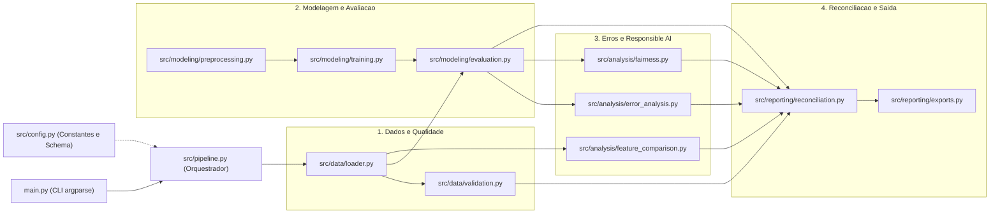

# Arquitetura Técnica — Adult Income: Model Evaluation & Fairness V2

## 1. Visão Arquitetural

A V2 adota uma **arquitetura procedural modular** em Python puro + Pandas + scikit-learn + Fairlearn + Pytest. Cada módulo tem responsabilidade única, contratos claros baseados em DataFrames, Series e dicionários simples, sem classes desnecessárias, sem abstrações artificiais e sem importações diretas de bibliotecas proibidas (`numpy`, `matplotlib`, `seaborn`, etc.).

---

## 2. Responsabilidade de Cada Módulo

| Módulo | Responsabilidade Principal | Funções-Chave |
| --- | --- | --- |
| `src/config.py` | Caminhos portáveis (`Path`), schema oficial de 14 features + target, proveniência OpenML/UCI, constantes V1, critério pré-registrado de seleção e limiares de alerta. | *(constantes e dicionários)* |
| `src/data/loader.py` | Leitura do CSV canônico local com verificação `SHA-256`, inspeção de cabeçalho duplicado e deslocamento de colunas (`RangeIndex(start=0, step=1)`), suporte ao `fetch_openml` histórico e split estratificado 80/20. | `calcular_sha256_arquivo`, `validar_estrutura_dataset`, `carregar_dataset_local`, `carregar_dataset_openml`, `separar_treino_teste` |
| `src/data/validation.py` | Auditoria reproduzível de tipos, ausentes (incluindo `workclass` × `occupation`), categorias inesperadas, duplicatas `(X, y)` e `X`, conflitos de alvo, sobreposição treino × teste, `fnlwgt`, extremos e categorias raras (com `normalizar_serie_texto` livre de downcasting implícito). | `normalizar_serie_texto`, `auditar_qualidade_dados` |
| `src/modeling/preprocessing.py` | Construção do `ColumnTransformer` separando pipeline numérica (`SimpleImputer(median)` + `StandardScaler`) e categórica (`SimpleImputer(most_frequent)` + `OneHotEncoder(handle_unknown="ignore")`). | `criar_preprocessador` |
| `src/modeling/training.py` | Fábricas de instâncias limpas (não ajustadas) das 4 pipelines (`DummyClassifier`, `LogisticRegression`, `DecisionTree` sem limite, `DecisionTree max_depth=7`) e previsão preservando o índice original. | `criar_pipeline_modelo`, `criar_catalogo_modelos`, `treinar_pipeline`, `gerar_previsoes` |
| `src/modeling/evaluation.py` | Validação cruzada 5-fold apenas no treino, estatísticas entre folds em Python puro, aplicação do critério pré-registrado de seleção e cálculo completo das métricas de teste com detecção de denominadores zero. | `calcular_estatisticas_folds`, `executar_validacao_cruzada_modelos`, `selecionar_melhor_modelo`, `calcular_metricas_classificacao` |
| `src/analysis/error_analysis.py` | Rotulagem mutuamente exclusiva (`TP`, `TN`, `FP`, `FN`), agrupamento explícito de faixa etária e faixa de horas (`if/elif/else`) e agregação descritiva em 7 dimensões. | `classificar_faixa_etaria`, `classificar_faixa_horas`, `classificar_tipo_erro`, `executar_analise_erros` |
| `src/analysis/fairness.py` | Auditoria com `MetricFrame`, `false_positive_rate`, `selection_rate`, `equal_opportunity_difference` e `equalized_odds_difference`, com wrappers seguros (`recall_seguro`, `fpr_seguro`) e escopo explícito integral/parcial/indefinido. | `recall_seguro`, `fpr_seguro`, `auditar_fairness_atributo`, `executar_auditoria_fairness` |
| `src/analysis/feature_comparison.py` | Experimento controlado comparando Cenário A (14 features) vs. Cenário B (12 features, sem `sex` e `race`) via `StratifiedKFold` 5-fold *out-of-fold* no treino e avaliação descritiva no teste, mantendo alinhamento estrito de índices. | `executar_comparacao_atributos_sensiveis` |
| `src/reporting/reconciliation.py` | 16 verificações matemáticas e metodológicas independentes (`VAL-01` a `VAL-16`), incluindo prova de ponderação correta vs. média simples e checagem anti-leakage no `StandardScaler`. | `executar_validacao_matematica` |
| `src/reporting/exports.py` | Serialização determinística (UTF-8, `LF`, sem timestamps voláteis) dos 14 relatórios usando escrita atômica (`.tmp -> replace()`) e rollback em melhor esforço caso o lote falhe. | `exportar_todos_relatorios` |
| `src/pipeline.py` | Orquestração sequencial completa, falhando antes da gravação se qualquer validação matemática for reprovada. | `executar_pipeline` |
| `main.py` | Interface de linha de comando (`argparse`) com códigos de saída padronizados (`0` sucesso, `1` falha interna, `2` erro de entrada/validação). | `construir_parser`, `main` |

---

## 3. Decisões de Engenharia e Justificativas

1. **Arquitetura procedural em vez de POO artificial:** funções puras com entradas e saídas explícitas reduzem acoplamento, facilitam testes unitários isolados e respeitam o nível atual de domínio de Python.
2. **Sem serialização `joblib`:** o objetivo deste projeto é um laboratório de avaliação e auditoria, não uma API de inferência. Evitar `.joblib` elimina complexidade e riscos de desserialização desnecessários.
3. **Fábricas de pipeline em vez de reutilizar estimadores mutáveis:** cada fold e cada cenário (A e B) cria uma nova `Pipeline` do zero, garantindo zero contaminação entre execuções sem precisar de `sklearn.base.clone`.
4. **Escrita atômica por arquivo + rollback do lote + determinismo:** evita relatórios corrompidos ou misturados entre execuções e permite reexecução idêntica byte a byte (`test_pipeline_offline_completo_consistencia_e_reexecucao_deterministica`).
5. **Preservação integral da V1:** `notebooks/adult_income_analysis.ipynb`, `INTERVIEW_NOTES.md` (raiz) e a branch `main` permanecem intocados.
